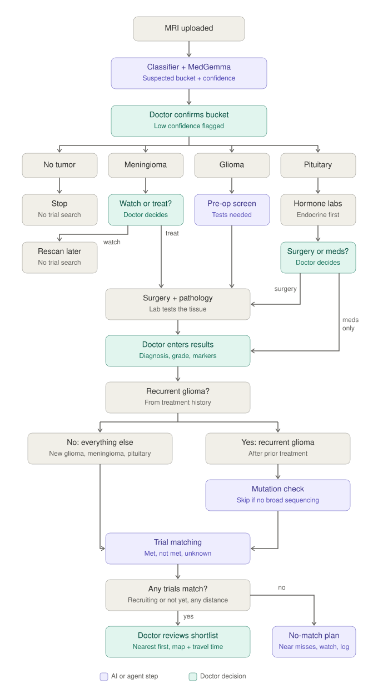
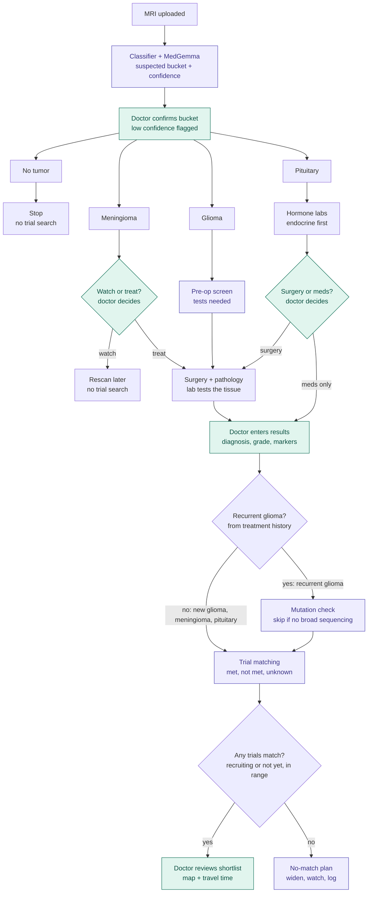

# Cortexa

An agentic care management platform supporting physician teams for suspected brain cancer diagnoses.

Cortexa classifies a brain MRI into a suspected tumor bucket (glioma, meningioma, pituitary, or no tumor), tells the team what the biopsy needs to answer, and matches confirmed cases to recruiting clinical trials. A doctor approves every step, and the agent never guesses what it can't know.

> Imaging tells you where to look. Pathology tells you what qualifies. DNA tells you what the treatment did. Cortexa knows the limits of each and makes the doctor confirm every step.

Built at tidalBYTE '26, Texas A&M, November 2026. Research prototype on synthetic data only. Not for clinical use.

## How it works

Same tree as Mermaid

Purple = AI or agent step. Teal = doctor decision. Extra rules are in [docs/decision-tree.md](docs/decision-tree.md).

1. **Classify:** a ResNet trained on 7,023 brain MRIs, cross-checked with MedGemma, suggests a tumor bucket and confidence.
2. **Confirm:** a doctor confirms or corrects the bucket.
3. **Pre-op screen (glioma):** the agent lists which biopsy results (IDH, 1p/19q, MGMT, grade) decide which trials, and flags trials that need enrollment before surgery.
4. **Results:** after surgery and pathology, the doctor enters the diagnosis and markers.
5. **Mutation check (recurrent glioma only):** Poisson NMF anomaly detection, borrowed from gamma-ray spectroscopy, tests for temozolomide's mutational fingerprint with a controlled false-alarm rate.
6. **Trial matching:** ClinicalTrials.gov and the NCI trials API. Every eligibility rule is marked met, not met, or unknown, with evidence. The doctor reviews the shortlist on a map.

## Repo layout

| Folder | What's in it |
|---|---|
| `classifier/` | MRI classifier, deduplication, heatmaps, MedGemma evaluation |
| `agent/` | Agent loop, trial APIs, eligibility checker, policy engine, audit log |
| `mutation_check/` | Mutation spectra, detection math, simulation |
| `clinical/` | Synthetic patient cases and reports, eligibility labels |
| `frontend/` | Web app |
| `policies/` | Runtime policy file |
| `docs/` | Decision tree and interfaces |

Contributors working with Claude Code: read [CLAUDE.md](CLAUDE.md) first.
