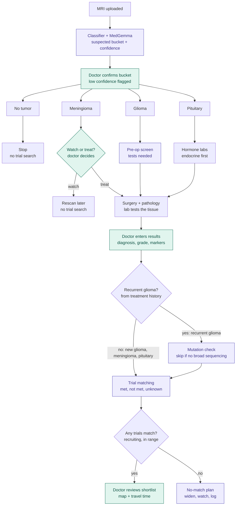

# Cortexa decision tree

This is the spec for the app's logic. Purple = AI or agent step. Teal = doctor decision.

The same tree as Mermaid (GitHub renders this natively):

## Rules on top of the tree

- **Missing results never block matching.** Rules that depend on a missing field are marked `unknown: needs pathology`.
- **Inconclusive mutation check = no information.** Matching continues without it. A high mutation count never routes to immunotherapy trials.
- **Pre-surgery trials.** The glioma pre-op screen flags trials that require enrollment before surgery.
- **Doctor overrides.** If the doctor changes the bucket, the case follows the new bucket's path.
- **Medication-only pituitary cases** skip surgery; the doctor enters hormone and imaging results directly.
- **No-match plan:** widen radius and include remote trials, show near misses, alert on newly opened trials, log "no current match" for the tumor board.
