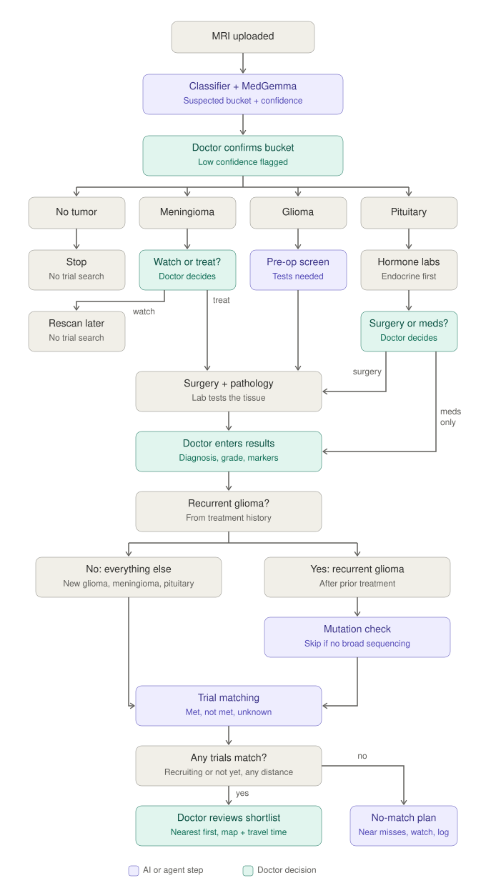
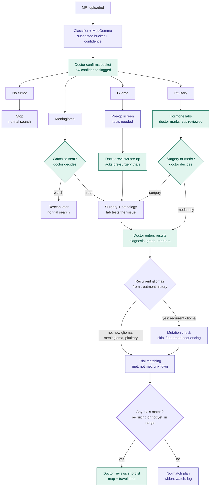

# Cortexa decision tree

This is the spec for the app's logic. Purple = AI or agent step. Teal = doctor decision.

The same tree as Mermaid (GitHub renders this natively):

## Rules on top of the tree

- **Missing results never block matching.** Rules that depend on a missing field are marked `unknown: needs pathology`.
- **Inconclusive mutation check = no information.** Matching continues without it. A high mutation count never routes to immunotherapy trials.
- **Pre-surgery trials.** The glioma pre-op screen flags trials that require enrollment before surgery.
- **Pre-op review gate.** Every glioma case stops after the pre-op screen until the doctor marks the biopsy tests reviewed and chooses `pursue_before_surgery` or `not_pursuing` for each flagged pre-surgery trial. None can be skipped. The window closes at surgery, so the gate applies even when no trial is flagged.
- **Doctor overrides.** If the doctor changes the bucket, the case follows the new bucket's path.
- **Hormone labs gate.** A pituitary case moves to surgery-or-meds only after the doctor marks the hormone labs reviewed.
- **Medication-only pituitary cases:** after hormone labs, the doctor chooses surgery or meds only. Meds only skips surgery; the doctor enters hormone and imaging results directly.
- **Trial statuses.** Search includes `RECRUITING` and `NOT_YET_RECRUITING`. Every trial shows its status label. A not-yet-recruiting trial is shown as "enrollment has not opened."
- **What counts as a match:** no criterion `not_met` and none waiting on a `pending` result. A **near miss** fails exactly one criterion, or has no failures but waits on a pending result.
- **No-match plan:** widen radius and include remote trials, show near misses, alert on newly opened trials, log "no current match" for the tumor board.
